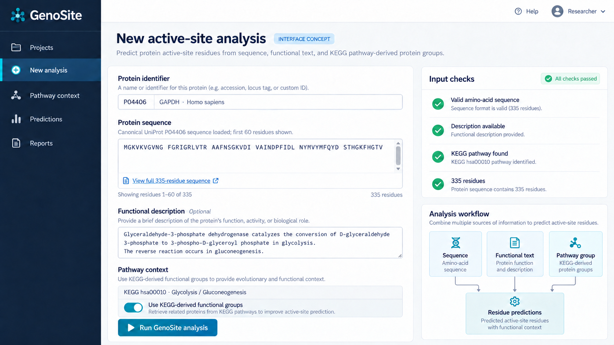
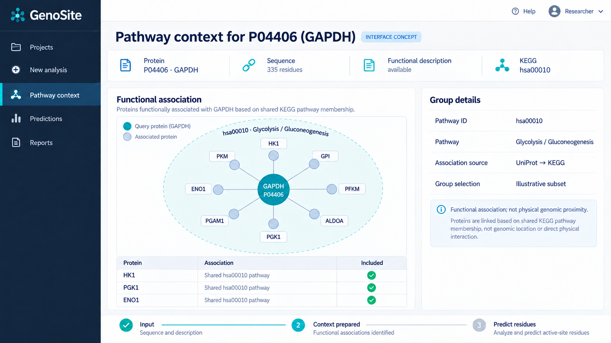
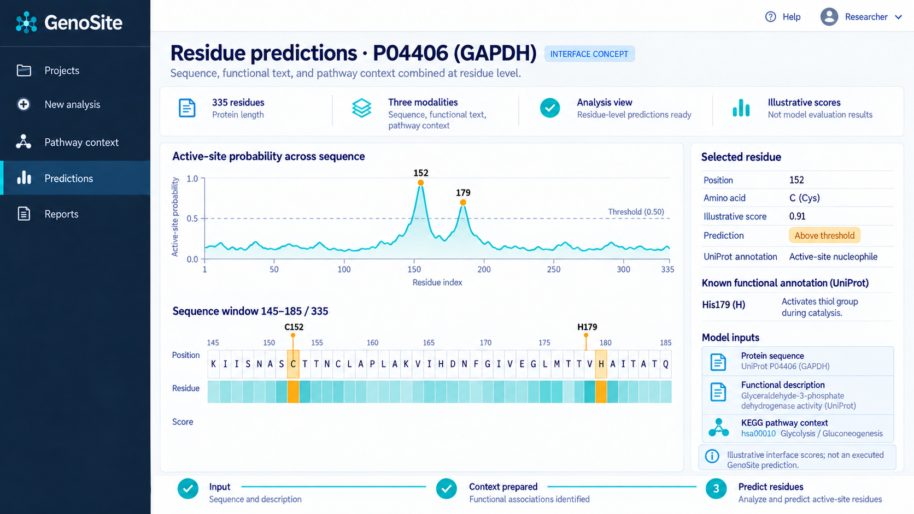
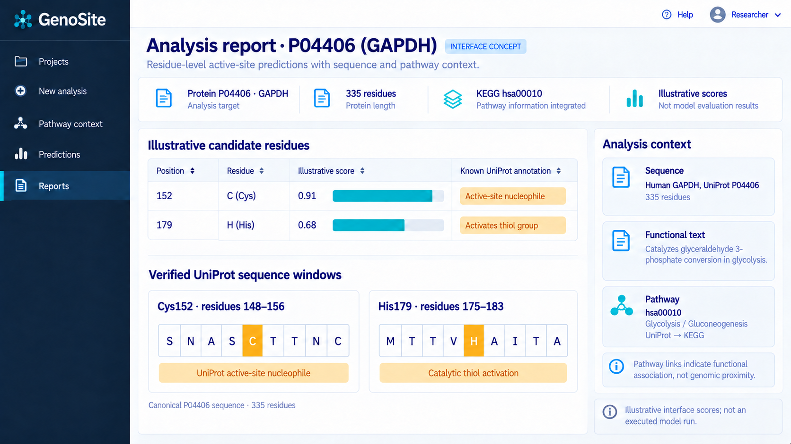

# GenoSite

**Pathway-Guided Multimodal Learning for Residue-Level Protein Active Site Prediction**

GenoSite predicts protein active-site residues by combining three sources of information: amino-acid sequence, protein functional descriptions, and KEGG pathway-derived functional context. Its goal is to use relationships among functionally associated proteins to improve residue-level predictions.

## Highlights

- **Three complementary modalities:** protein sequence, functional text, and pathway-derived protein groups.
- **Pathway-guided context:** proteins associated with the same pathway provide functional context beyond an individual protein.
- **Residue-level output:** the model assigns an active-site prediction to each residue in the input sequence.
- **Evaluated under a strict sequence split:** the primary ProTAD evaluation uses a 10% sequence-identity setting.

> **Terminology:** The pathway-derived groups in GenoSite represent curated functional associations. They do not represent chromosomal proximity, physical gene order, or genomic neighborhoods.

## How GenoSite works

| Component | Information used | Role |
| --- | --- | --- |
| Protein language model | Amino-acid sequence | Encodes residue-level sequence features |
| Biomedical language model | UniProt-derived functional descriptions | Encodes protein-level functional information |
| Pathway context encoder | UniProt-to-KEGG pathway associations | Encodes groups of functionally associated proteins |

The three representations are projected into a shared space and combined through hierarchical multimodal interaction. Adaptive protein-level fusion then supplies functional context to the residue-level prediction module. In the pathway construction used in the study, retained groups contain 15–30 proteins.


## Interface previews

The four images below present a proposed GenoSite software interface using **human GAPDH (UniProt: P04406)** as a consistent example. Its canonical sequence has 335 amino acids, and KEGG lists it in **hsa00010: Glycolysis / Gluconeogenesis**. The protein identity, displayed sequence fragments, pathway membership, and cited residue annotations correspond to public records. The interface and prediction scores are illustrative; these images are not screenshots of an executed GenoSite analysis.

### 1. Protein input

The input view shows the P04406 identifier, a preview of its canonical amino-acid sequence, a functional description, and the selected KEGG-derived pathway context. The sequence preview displays residues 1–60 of the full 335-residue protein.



### 2. Pathway context

The context view places GAPDH alongside selected human proteins from the same **hsa00010** pathway. Connections indicate shared pathway membership and functional association; they do not indicate physical genomic proximity or direct protein interaction.



### 3. Residue-level prediction

The prediction view illustrates per-residue scores across the 335-amino-acid sequence and zooms in on the region containing **Cys152** and **His179**. UniProt annotates Cys152 as an active-site nucleophile and His179 as a residue that activates a thiol group during catalysis. The plotted scores are example interface data, not measured GenoSite outputs.



### 4. Analysis report

The report view brings together illustrative candidate scores, the corresponding UniProt annotations, short verified sequence windows, and the KEGG pathway context. It shows how a future interface could make residue-level results inspectable in one place.



Protein sequence and residue annotations: [UniProt P04406](https://www.uniprot.org/uniprotkb/P04406). Pathway membership: [KEGG hsa:2597](https://www.kegg.jp/entry/hsa:2597) and [hsa00010](https://www.kegg.jp/entry/hsa00010).
## Repository structure

```text
genosite/
├── config/
│   └── config.yaml              # Model and training configuration
├── dataprocess/                  # Dataset preparation guidance and scripts
├── datasets/
│   └── infer_samples.tsv        # Example input data
├── pathway/                      # UniProt-to-KEGG mapping and group preparation
├── pretrained_weights/
│   └── placeholder              # Location for external model assets
├── utils/                        # Shared utilities
├── environment.yml              # Reference Conda environment
├── requirements.txt             # Partial dependency list
├── inference.py                  # Research inference script
├── model.py                      # GenoSite model
└── train.py                      # Training and evaluation
```

## Data and required assets

The repository does not contain the complete training dataset, pretrained model weights, generated descriptions, or pathway embeddings. Prepare these assets before training or inference:

| Asset | Expected location or configuration |
| --- | --- |
| Training, validation, and test splits | `datasets/train.tsv`, `datasets/valid.tsv`, `datasets/test.tsv` |
| Inference input | `datasets/infer.tsv` |
| Generated functional descriptions | Path set by `prior_knowledge` in `config/config.yaml` |
| Protein and biomedical language-model assets | `pretrained_weights/` |
| Pathway group embeddings used by the current training code | `gLM/batch.pkl.glm.embs.pkl` |
| Trained GenoSite checkpoint for inference | `pretrained_weights/` |

The configuration currently points `prior_knowledge` to `datasets/generated_desc_test.json`. Check all asset paths in `config/config.yaml` against your local files.

For the ProTAD data source, sequence splitting, and functional-description preparation, see [data preparation](dataprocess/README.md). The scripts in `pathway/` cover UniProt ID extraction, UniProt-to-KEGG mapping, pathway group construction, and preparation of group-encoder inputs. Producing the embeddings consumed by training also requires the corresponding group-encoding step and its model assets.

## Environment

`environment.yml` records a reference Conda environment named `mmsite01`:

```bash
conda env create -f environment.yml
conda activate mmsite01
```

This environment file contains platform-specific packages, and `requirements.txt` is only a partial dependency list. Depending on the operating system and available CUDA setup, additional dependency installation or version adjustments may be needed.

## Training

After preparing the datasets and model assets, start training with the configuration file that exists in this repository:

```bash
python train.py --config config/config.yaml
```

Review `config/config.yaml` before running. In particular, confirm the dataset paths, pretrained model paths, generated-description path, device setting, and pathway embedding file. The training script contains alignment, fusion, and evaluation stages; a clean checkout alone does not supply all inputs required by those stages.

## Inference

`inference.py` is a research script rather than a ready-to-run application. Before using it, prepare `datasets/infer.tsv` with `Entry` and `Sequence` columns, supply the required functional descriptions and checkpoint, and update its hard-coded configuration and checkpoint paths for your local setup.

The current inference call does not pass protein entry IDs to the pathway lookup in `model.py`; consequently, this entry point uses a zero pathway vector. To evaluate the full pathway-guided model on new proteins, the inference path must also provide their pathway embeddings and pass the corresponding entry IDs.

## Scope and interpretation

Pathway annotations and functional descriptions can be related to the biological labels being predicted. Evaluation of pathway-guided models should therefore consider annotation overlap and potential information leakage. The additional pathway-focused analyses in the paper provide supporting interpretation; they are not independent clinical validation.

## Citation

If GenoSite is useful in your research, please cite the paper:

> Xianjun Han, Zhijian Deng, Yongfu Zhu, Zijian Wu, Can Bai, and Renbao Huang. **GenoSite: Pathway-Guided Multimodal Learning for Residue-Level Protein Active Site Prediction.**

A publication link, DOI, and formal BibTeX entry can be added once they are available.

## License

No license file is currently included in this repository. Please contact the authors about reuse permissions.
